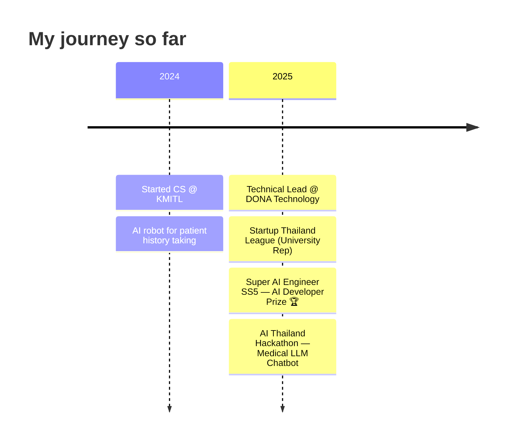

<!-- ═══════════════════════ HEADER ═══════════════════════ -->
<p align="center">
  
</p>

<p align="center">
  <a href="https://git.io/typing-svg">
    
  </a>
</p>

<p align="center">
  
  <a href="https://github.com/GNATAS?tab=followers"></a>
  <a href="mailto:paphawit145@gmail.com"></a>
</p>

---

## 👨‍💻 About Me

```python
class Paphawit:
    def __init__(self):
        self.location   = "Bangkok, Thailand 🇹🇭"
        self.education  = "B.Sc. Computer Science @ KMITL (2024 - now)"
        self.role       = "Technical Lead @ DONA Technology"
        self.focus      = ["AI / Machine Learning", "LLM", "NLP", "MLOps & Infra"]
        self.currently  = "Shipping AI from notebook ➜ API ➜ Docker ➜ production"

    def say_hi(self):
        return "Let's build AI products that actually ship! 🚀"
```

---

## 🛠️ Tech Stack

<p align="center">
  <br/>
  <br/>
  
</p>

<p align="center">
  
  
  
  
  
  
  
</p>

---

## 🏆 Achievements

| | Achievement | When |
|:-:|---|:-:|
| 🥇 | **AI Developer Prize** — Super AI Engineer Season 5 (AIAT) | 2025 |
| 🧪 | **Qualified Team** — AI Thailand Hackathon 2025 (NECTEC) | Aug 2025 |
| 🎓 | **University Representative** — Startup Thailand League 2025 | May–Jun 2025 |

<details>
<summary><b>🗺️ Journey timeline (click to expand)</b></summary>

<br/>



</details>

---

## 🚀 Featured Projects

<p align="center">
  <a href="https://github.com/GNATAS/English-Accent-Classification">
    
  </a>
  <a href="https://github.com/GNATAS/Histora_Medical_Chatbot">
    
  </a>
  <a href="https://github.com/GNATAS/Plant-Health-Prediction">
    
  </a>
  <a href="https://github.com/GNATAS/olmocr">
    
  </a>
</p>

| Project | What it does | Stack |
|---|---|---|
| 🎙️ [English Accent Classification](https://github.com/GNATAS/English-Accent-Classification) | Classifies speech into 9 English accents with a 5-seed MLP ensemble + **Accent Quest** practice game | `Python` `FastAPI` `log-Mel` `MLP` |
| 🩺 [Histora Medical Chatbot](https://github.com/GNATAS/Histora_Medical_Chatbot) | Thai LLM chatbot that takes patient history and summarizes it for doctors (AI Thailand Hackathon) — I handled DevOps | `Typhoon2.1-Gemma3-12B` `FastAPI` `SQLite` `Docker` |
| 🌱 [Plant Health Prediction](https://github.com/GNATAS/Plant-Health-Prediction) | ML pipeline predicting plant health with feature selection + decision tree | `scikit-learn` `Jupyter` |
| 📄 [olmOCR (fork)](https://github.com/GNATAS/olmocr) | Exploring allenai's toolkit for linearizing PDFs for LLM training data | `Python` `VLM` |
| 💸 [Crowdfunding MVC](https://github.com/GNATAS/MVCproject) | Crowdfunding platform built with a clean MVC architecture | `Python` `SQLite` |

---

## 📊 GitHub Stats

<p align="center">
  
  
</p>

<p align="center">
  
</p>

<p align="center">
  
</p>

<p align="center">
  
</p>

---

## 🐍 Contribution Snake

<p align="center">
  <picture>
    <source media="(prefers-color-scheme: dark)" srcset="https://raw.githubusercontent.com/GNATAS/GNATAS/output/github-contribution-grid-snake-dark.svg" />
    <source media="(prefers-color-scheme: light)" srcset="https://raw.githubusercontent.com/GNATAS/GNATAS/output/github-contribution-grid-snake.svg" />
    
  </picture>
</p>

---

<p align="center">
  
</p>


